
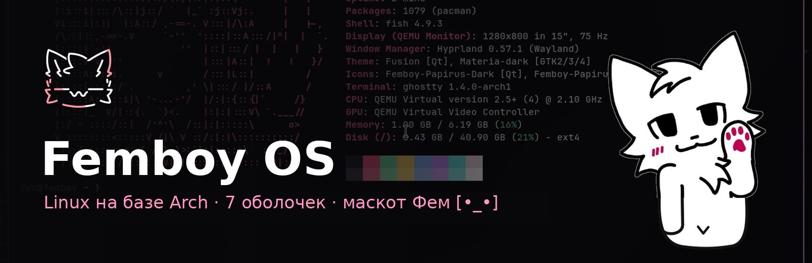

  
  
  

**Femboy OS** — дистрибутив Linux на базе Arch с ядром `linux-zen`: свой красивый установщик со стеклом и анимациями,
семь оболочек на выбор, помощник **Furry++** и маскот **Фем [•_•]**, который гуляет по рабочему столу,
машет лапкой, смущается, валяется и засыпает прямо на панели задач.

> Привет! Я Фем — фури-помощник Femboy OS. Я помогу поставить систему, а потом встречу тебя на рабочем столе :3

## Скачать

**[⬇ Скачать ISO со страницы релиза](../../releases/latest)** — один файл, 1,99 ГБ.

Как поставить на любой компьютер с BIOS / UEFI — пошагово, со скриншотами:
**[инструкция](https://nezertezertul-maker.github.io/FemboyOS/)** · [запасная ссылка](https://raw.githack.com/nezertezertul-maker/FemboyOS/main/index.html) · или файл [`index.html`](index.html) — скачай и открой в браузере.

Коротко: запиши ISO на флешку (balenaEtcher, Rufus в режиме DD или Ventoy) → загрузись с неё (F12 / F11 / F8 / Esc) →
если не грузится, выключи Secure Boot в BIOS → дальше всё делает установщик вместе с Фемом.

## Оболочки

Выбираются один раз при установке. Каждая уже настроена: обои, иконки, курсоры, логотип Femboy OS.

| | |
|:---:|:---:|
| 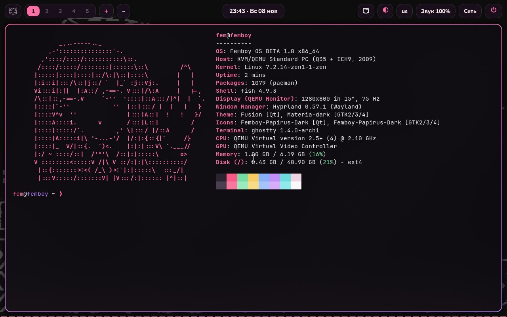 **Hyprland** — тёмное стекло, Ghostty + fish, 5 рабочих столов | 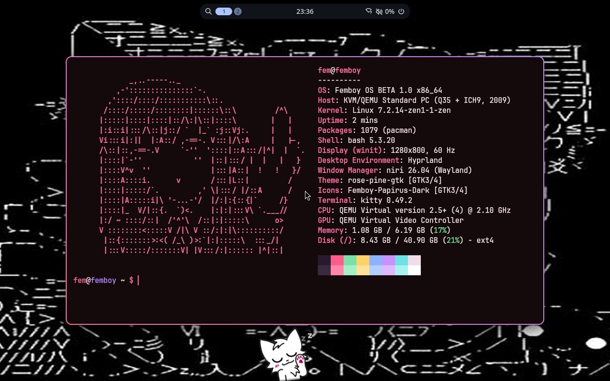 **niri + Noctalia** — Rose Pine, лента окон |
| 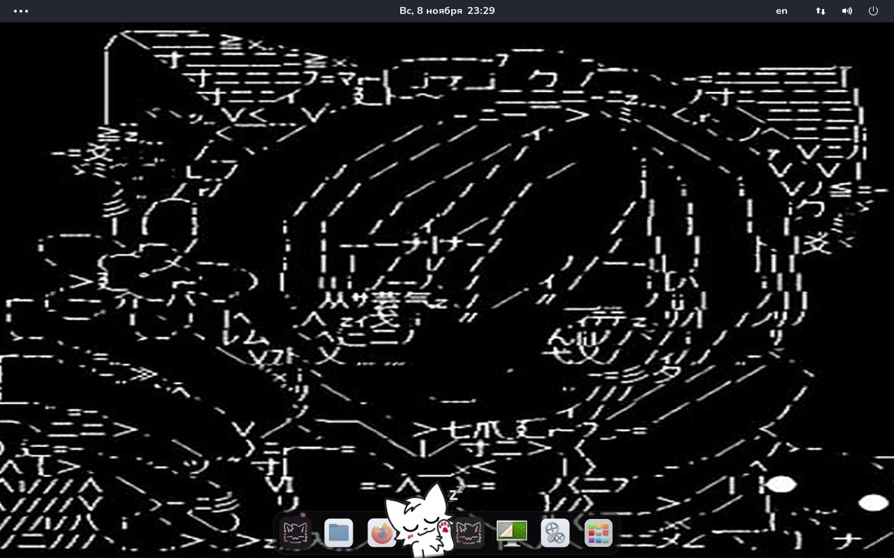 **GNOME** — WhiteSur, Nordzy, док снизу | 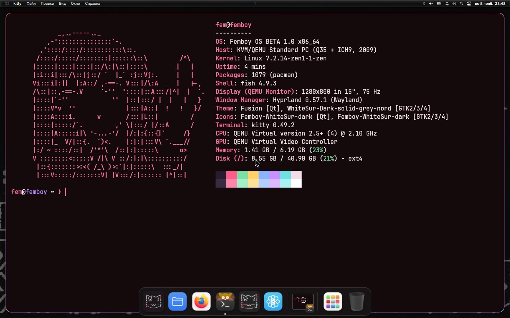 **MacShell** — как macOS, жидкое стекло |
| 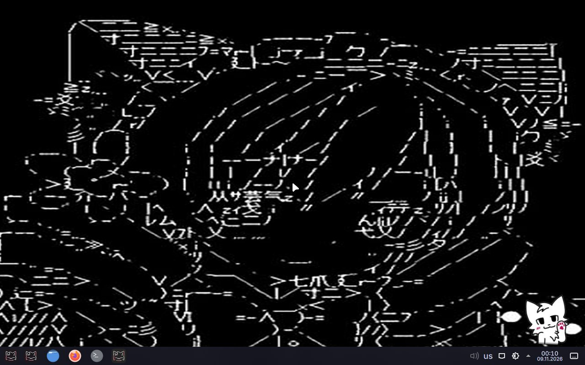 **KDE Plasma** — Catppuccin Mocha *(ставится из интернета)* | 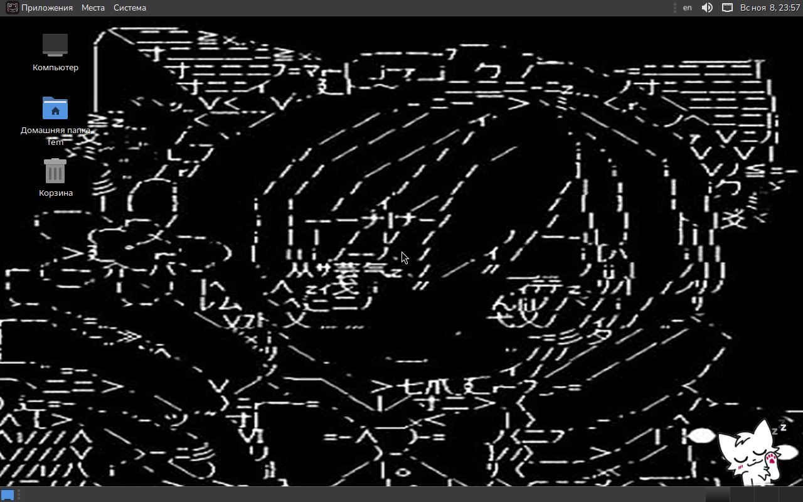 **MATE** — для старых компьютеров *(из интернета)* |

И ещё **Caelestia** — Material You на Hyprland (собирается из AUR при установке).

## Установщик

| | |
|:---:|:---:|
| 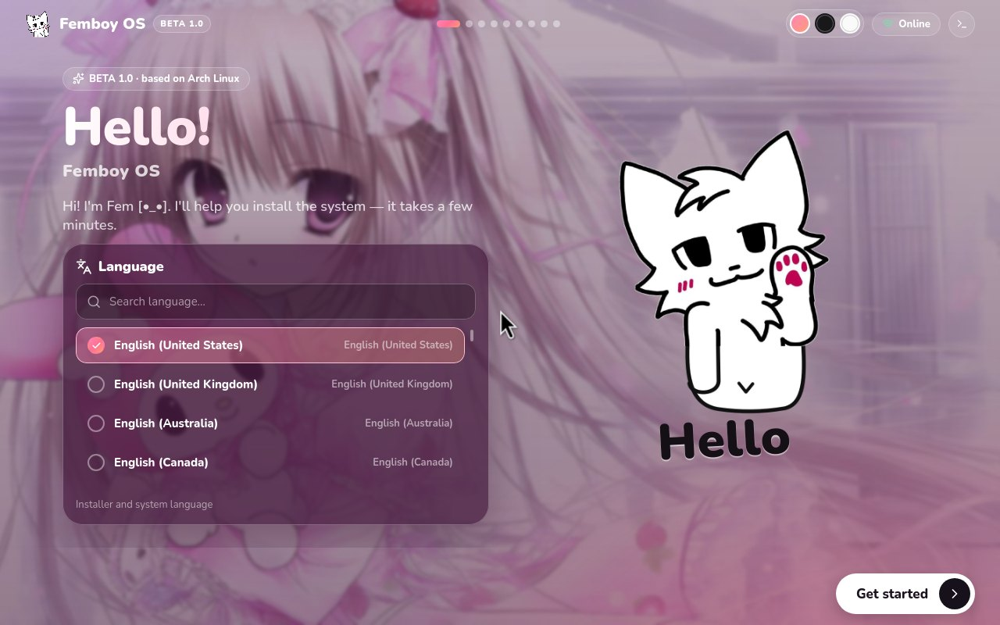 | 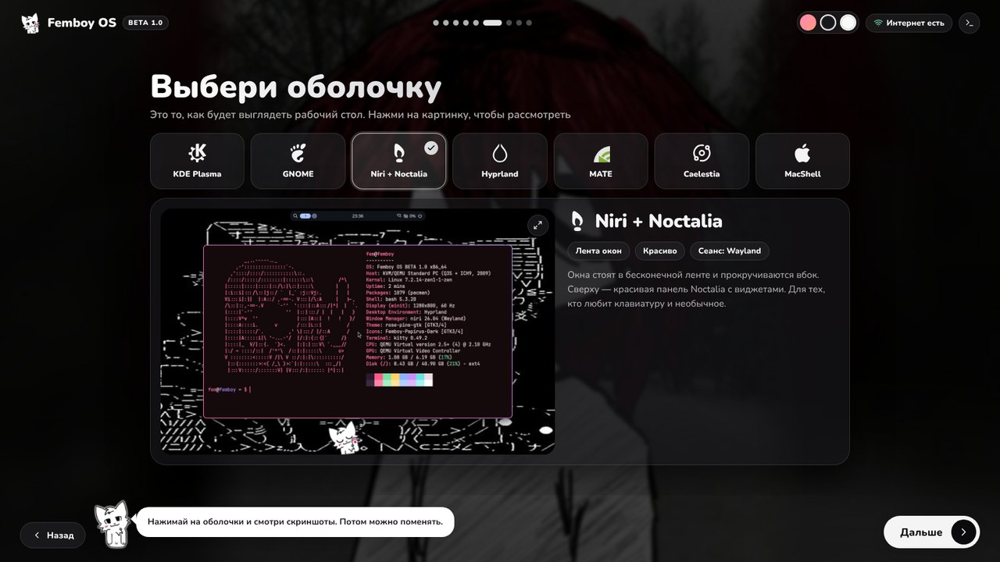 |
| Язык — «привет» на выбранном языке | Выбор оболочки с настоящими скриншотами |
| 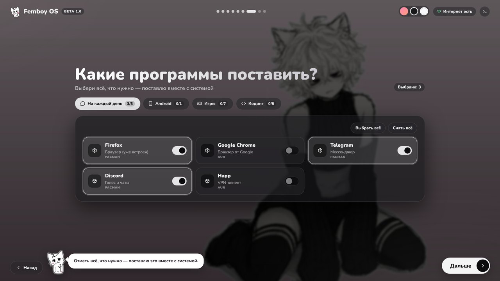 | 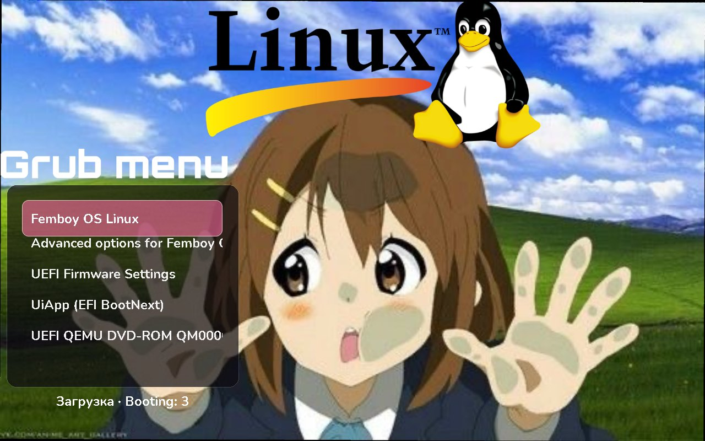 |
| Наборы программ: игры, кодинг, Android (.apk) | Своё меню загрузки «Grub menu» |

Без интернета ставятся GNOME, niri, Hyprland и MacShell. Есть ноутбук с разбитым экраном? Подключи внешний
монитор до включения — установщик сам переключится на него.

## Furry++ и Фем

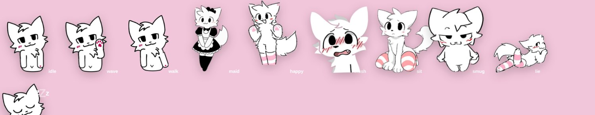

| | |
|:---:|:---:|
| 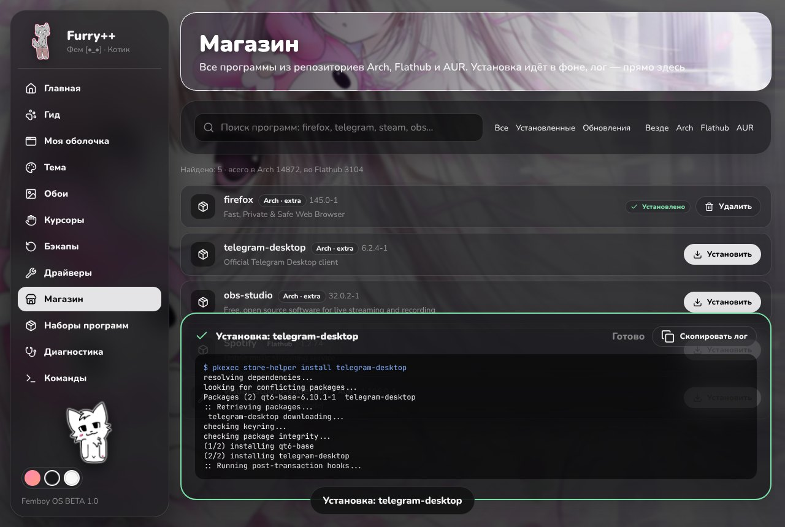 | 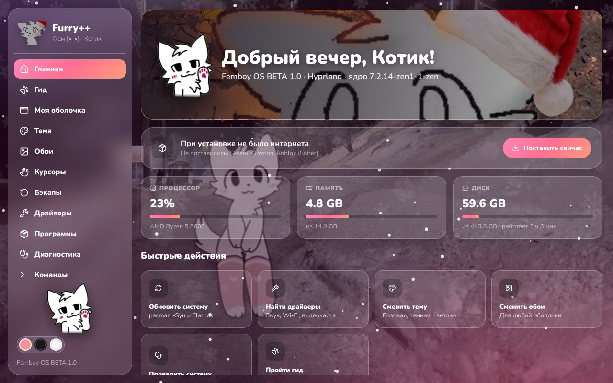 |
| **Магазин** — все программы Arch, Flathub и AUR; установка в фоне с логом прямо в окне | Зимой — новогодняя иконка, снег и зимние картинки |

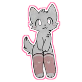

**Furry++** — гид по системе от Фема, темы (розовая / тёмная / светлая), обои (`Super+T` — карусель),
курсоры, драйверы, диагностика с кнопкой «Починить», бэкапы, команды и инструкция к твоей оболочке.

## Что ещё внутри

- **Бэкапы и откат.** Перед каждым обновлением — снимок системы и копия настроек; после — самопроверка.
  Всё работает — снимок удаляется, что-то сломалось — система сама откатится при перезагрузке.
- **Драйверы.** Видеокарта (AMD / Intel / NVIDIA), Wi-Fi (в том числе Broadcom), звук, Bluetooth — находятся и включаются сами.
- **Меню «Пуск»** (`Ctrl+Esc`) и логотип-котик вместо значка Arch.
- **Android-приложения** через Waydroid: `.apk` открывается двойным кликом.

## Требования

64-битный компьютер · 4 ГБ ОЗУ · 20+ ГБ на диске · флешка на 8 ГБ.

## Куда ставить

- **Весь диск** — диск стирается, установщик сам делает разделы.
- **Рядом с Windows / macOS** — в свободное (неразмеченное) место; другие разделы не трогаются,
  загрузчик ложится в существующий EFI-раздел (флаг `esp/boot`), Windows остаётся в меню загрузки.
- **Свой раздел** — выбираешь заранее созданный раздел (видны флаги `esp`, `boot`, `bios_grub`, `msftdata`),
  он форматируется, EFI-раздел выбирается отдельно и не форматируется.

---

Femboy OS BETA 1.2 · на базе <a href="https://archlinux.org">Arch Linux</a>. Это бета: сначала попробуй в виртуальной машине или на запасном компьютере.
